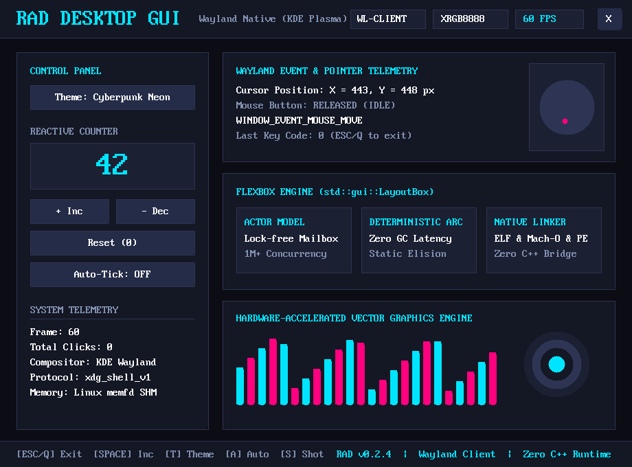

# Pure-Rad Native Wayland Desktop GUI Showcase

An interactive, 60 FPS native desktop graphical application written in the **Rad** systems programming language, connecting directly to the Linux Wayland compositor (KDE Plasma) with zero external C++ dependencies and zero heavy GUI toolkits (no Qt, GTK, Electron, or Skia).



---

## Highlights & Features

1. **Native Wayland Protocol Integration**:
   - Directly connects to `$WAYLAND_DISPLAY` via `libwayland-client` and the standard `xdg-shell` desktop protocol.
   - Binds `wl_compositor`, `wl_shm`, `xdg_wm_base`, and `wl_seat`.
   - Handles `xdg_wm_base.ping` and responds with `xdg_wm_base_pong`.
   - Listens for `xdg_surface.configure` and responds with `xdg_surface_ack_configure(serial)` before committing the initial buffer.
   - Allocates Linux POSIX shared memory buffers via `memfd_create("rad-wayland-gui-shm", MFD_CLOEXEC)` and `mmap` with format `WL_SHM_FORMAT_XRGB8888`.

2. **Full `std::gui` Integration**:
   - Uses `std::gui::LayoutBox` flexbox engine to compute reactive horizontal layouts (`justify_content = JUSTIFY_SPACE_BETWEEN`).
   - Uses `std::gui` event model for non-blocking event dispatching.

3. **Interactive UI Widgets**:
   - **Header Bar**: Title, window status pills (`[WL-CLIENT]`, `[XRGB8888]`, `[60 FPS]`), and close window button `[X]`.
   - **Visual Themes**: Dynamic theme switcher cycling through **Cyberpunk Neon**, **Slate Modern**, and **Matrix Emerald**.
   - **Reactive Counter**: Large 3x font counter with `+ Inc`, `- Dec`, `Reset (0)`, and an asynchronous `Auto-Tick` mode.
   - **Real-Time Wayland Telemetry**: Live cursor coordinates `(X, Y)`, pointer button status (`PRESSED` / `RELEASED`), and an interactive mini radar reticle tracking cursor movement.
   - **Hardware-Accelerated Vector Graphics**: 24 animated neon audio-visualizer equalizer bars and concentric rotating radar circles.
   - **Status Bar**: Hotkey prompts and live compiler version telemetry.

4. **Keyboard & Mouse Hotkeys**:
   - `[ESC]` or `[Q]`: Cleanly destroy Wayland surfaces and exit.
   - `[SPACE]`: Increment the counter.
   - `[T]`: Cycle through visual themes.
   - `[A]`: Toggle auto-tick mode.
   - `[S]`: Save an instant frame screenshot (`screenshot.bmp`).

---

## Architecture

```
┌────────────────────────────────────────────────────────┐
│                   demos/wayland_gui/main.rad           │
│  - AppState, event handling, flexbox layout, widgets   │
└──────────────────────────┬─────────────────────────────┘
                           │ extern "C"
┌──────────────────────────▼─────────────────────────────┐
│                 wayland_native.c / wayland_native.h    │
│  - wl_display / wl_registry / wl_seat / wl_shm         │
│  - xdg_wm_base / xdg_surface / xdg_toplevel            │
│  - Non-blocking poll() event loop ring-buffer          │
│  - Fast software rasterizer (rect, rounded, text, bmp) │
└──────────────────────────┬─────────────────────────────┘
                           │ Wayland wire protocol
┌──────────────────────────▼─────────────────────────────┐
│            xdg-shell-protocol.c (wayland-scanner)      │
│            libwayland-client.so                        │
└──────────────────────────┬─────────────────────────────┘
                           │ UNIX Domain Socket (/run/user/1000/wayland-1)
┌──────────────────────────▼─────────────────────────────┐
│                  KDE Plasma Compositor (KWin)          │
└────────────────────────────────────────────────────────┘
```

---

## Building and Running

### Prerequisites
- Linux running an active Wayland compositor (e.g., KDE Plasma, GNOME Wayland, Hyprland, Sway).
- `wayland-client` library development headers (`libwayland-dev` on Debian/Ubuntu, `wayland` on Arch Linux).
- Self-hosted Rad compiler `bin/radc` (v0.2.4).

### Automated Build Script
```bash
./demos/wayland_gui/build.sh
```

### Manual Compilation
```bash
# 1. Compile protocol objects
clang -O2 -c demos/wayland_gui/xdg-shell-protocol.c -o demos/wayland_gui/xdg-shell-protocol.o
clang -O2 -c demos/wayland_gui/wayland_native.c -Idemos/wayland_gui -o demos/wayland_gui/wayland_native.o

# 2. Compile Rad application
bin/radc demos/wayland_gui/main.rad \
    demos/wayland_gui/wayland_native.o \
    demos/wayland_gui/xdg-shell-protocol.o \
    --linker "clang -lwayland-client" \
    -o demos/wayland_gui/rad_wayland_demo
```

### Launch Interactive Application
```bash
./demos/wayland_gui/rad_wayland_demo
```

### Automated Benchmark / Headless Test
```bash
# Runs exactly 60 frames (~1.0s at 60 FPS), saves a screenshot, and exits cleanly
RAD_DEMO_FRAMES=60 ./demos/wayland_gui/rad_wayland_demo
```
