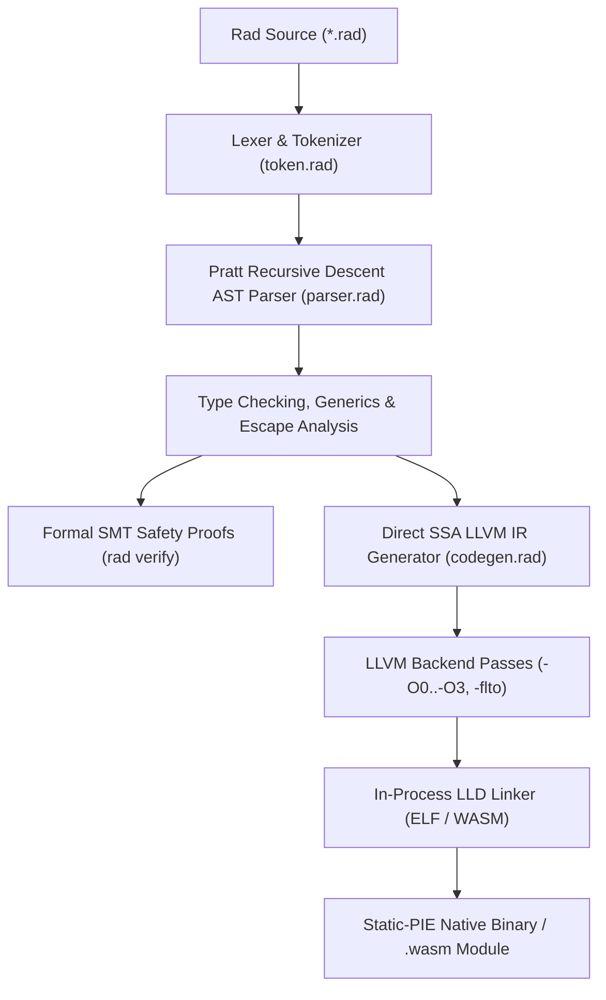
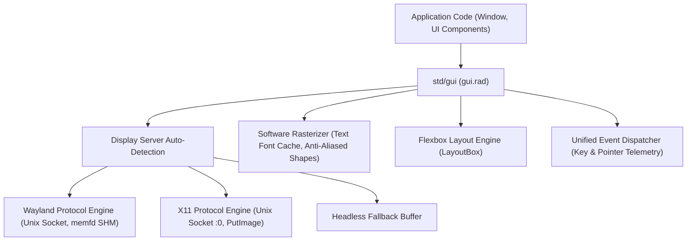

# Rad Systems Programming Language — Authoritative Engineering Guide

The **Rad programming language** is a modern, statically typed, self-hosted systems programming language designed for writing high-performance, predictable, and robust native software. Rad combines the mechanical sympathy, zero-cost abstractions, and raw pointer performance of C with the safety, modularity, and expressiveness of modern languages—without requiring a tracing garbage collector or runtime interpreter.

Rad features an in-process toolchain producing zero-dependency **Static Position-Independent Executables (`static-pie`)** via bundled musl libc and LLD, a 100% pure-Rad native desktop GUI engine for Wayland and X11, hardware Vulkan GPU compute pipelines with pure-Rad SPIR-V emission, formal SMT verification, flow-sensitive escape analysis with heap-to-stack promotion, a SAT-based SemVer dependency solver with Ed25519 signing, and a standardized Language Server Protocol (LSP) daemon.

---

## 1. Toolchain Architecture & Execution Model

Rad is completely self-contained. Binaries compiled with `radc` or `rad build` link against a bundled static musl sysroot using an in-process LLD linker.



### Core Toolchain Components
1. **`radc` (Compiler)**:
   - Location: `~/.rad/bin/radc` or `./bin/radc`
   - Direct SSA LLVM IR emitter with multi-error recovery and typo suggestions.
   - Command flags:
     - `-o <path>`: Specify output binary path.
     - `-O0`, `-O2`, `-O3`: Optimization levels.
     - `-flto`: Enable Full Link-Time Optimization.
     - `-s`: Strip symbols for minimal binary size.
     - `--emit-llvm`: Output human-readable LLVM IR (`.ll`).
     - `--check`: Fast semantic analysis without emitting object files.
     - `-I <dir>`: Add module search include directory.
2. **`rad` (Package Manager & Orchestrator)**:
   - Location: `~/.rad/bin/rad` or `./bin/rad`
   - Unified build, package, test, formatting, LSP, and verification tool.
   - Manifest: `rad.toml` in project root; lockfile: `rad.lock`.
3. **Bundled Toolchain Support**:
   - `rcrt1.o`, `crti.o`, `libc.a`, `libclang_rt.builtins-x86_64.a`, `crtn.o` in `lib/targets/x86_64-unknown-linux-musl/`.
   - WebAssembly target: `wasm32-unknown-unknown`.

---

## 2. Core Language Syntax & Type System

### 2.1 Program Structure & Entry Point

Execution begins at `fn main()`:

```rad
// Option 1: Standard entry returning exit code
fn main() -> i32 {
    println("Hello, Rad!")
    return 0
}

// Option 2: Void entry (implicit exit code 0)
fn main() {
    println("Runs and exits with 0 automatically")
}

// Option 3: Command-line arguments entry
fn main(argc: i32, argv: *raw *raw u8) -> i32 {
    println("Arg count: {}", argc)
    println("Program: {}", argv[0usize] as str)
    return 0
}
```

> [!IMPORTANT]
> Semicolons are optional between statements on separate lines. Explicit `return` statements are **mandatory** when returning a value; trailing expressions do not automatically return values.

---

### 2.2 Variables, Constants & Mutability

- **`let`**: Declares an immutable variable binding (cannot be reassigned).
- **`var`**: Declares a mutable variable binding.
- **`const`**: Declares a compile-time constant evaluated before code generation.

```rad
const MAX_PACKET_SIZE: usize = 65536usize
let server_ip: str = "127.0.0.1" // Immutable
var active_connections: i64 = 0   // Mutable

active_connections = active_connections + 1i64
// server_ip = "0.0.0.0"  <-- Error: cannot assign to immutable variable 'server_ip'
```

---

### 2.3 Data Types & Memory Representation

| Category | Types | Storage & Notes | Example Literal |
|---|---|---|---|
| **Signed Integers** | `i8`, `i16`, `i32`, `i64`, `isize` | Two's complement representation (`i32` is default) | `42`, `-10i8`, `100i64` |
| **Unsigned Integers**| `u8`, `u16`, `u32`, `u64`, `usize` | Zero-extended arithmetic | `255u8`, `1024u32`, `0usize` |
| **Floating-Point** | `f32`, `f64` | IEEE-754 single and double precision | `3.14159f32`, `2.71828` |
| **Boolean** | `bool` | 8-bit byte representation | `true`, `false` |
| **Characters & Text**| `char`, `str` | `char` is 32-bit Unicode; `str` is `*raw u8` null-terminated C string | `'A'`, `"Hello, Rad!"` |
| **Raw Pointers** | `*raw T`, `*raw var T` | Untracked raw machine pointers with array indexing `ptr[i]` | `p as *raw u8` |
| **Dynamic Slices** | `[]T` | 24-byte fat slice `{ ptr, cap, len }` with runtime bounds checking | `[10, 20, 30]` |

---

### 2.4 Control Flow

#### Conditionals
```rad
if score >= 90 {
    println("Grade: A")
} else if score >= 80 {
    println("Grade: B")
} else {
    println("Grade: C or below")
}
```

#### While Loops
```rad
var i: i64 = 0
while i < 10i64 {
    i = i + 1i64
    if i == 5i64 { continue }
    if i > 8i64 { break }
}
```

#### For-In Loops
```rad
// Range loop: [start..end) exclusive
for i in 0..10 {
    println(i)
}

// Slice / array iteration
let items = [100, 200, 300]
for x in items {
    println(x)
}
```

---

### 2.5 Generics, Structs & Methods

Rad supports full generic structs, methods, and monomorphization:

```rad
pub struct Pair<A, B> {
    pub first: A,
    pub second: B,
}

impl<A, B> Pair<A, B> {
    pub fn new(a: A, b: B) -> Pair<A, B> {
        return Pair { first: a, second: b }
    }

    pub fn get_first(self) -> A {
        return self.first
    }

    pub fn get_second(self) -> B {
        return self.second
    }
}

// Using dot constructors
let p = Pair::new(10i64, "success")
println("Pair: {}, {}", p.get_first(), p.get_second())
```

#### Mutating Methods
Methods taking `var self` or `*raw var Struct` can mutate fields in-place:
```rad
pub struct Counter {
    pub value: i64,
}

impl Counter {
    pub fn increment(var self, step: i64) {
        self.value = self.value + step
    }
}
```

---

### 2.6 Enums & Pattern Matching

Enums can carry variant data payloads and be unpacked using pattern matching:

```rad
enum Shape {
    Circle(f32),
    Rectangle(f32, f32),
    Point,
}

fn area(s: Shape) -> f32 {
    match s {
        Shape::Circle(r) => { return 3.14159 * r * r; }
        Shape::Rectangle(w, h) => { return w * h; }
        Shape::Point => { return 0.0; }
        _ => { return 0.0; }
    }
}
```

Standard types `Option<T>` and `Result<T, E>` are predefined:
```rad
enum Option<T> { Some(T), None }
enum Result<T, E> { Ok(T), Err(E) }
```

---

### 2.7 Traits & Dynamic Polymorphism (`dyn Trait`)

Rad supports static compile-time monomorphization and dynamic runtime polymorphism via fat pointer vtables:

```rad
trait Drawable {
    fn draw(self);
}

struct Button {
    label: str,
}

impl Drawable for Button {
    fn draw(self) {
        println("Drawing button: {}", self.label)
    }
}

// Dynamic dispatch via dyn Trait
fn render_element(d: dyn Drawable) {
    d.draw()
}
```

---

### 2.8 Concurrency: Actor Model & Async/Await

Rad features a built-in Actor model and async task runtime:

```rad
import std/actor;
import std/task;

actor Worker {
    var job_count: i64;

    fn handle_message(var self, msg: str) {
        self.job_count = self.job_count + 1i64;
        println("Processing job {}: {}", self.job_count, msg);
    }
}

async fn fetch_data() -> i32 {
    return 42;
}

fn main() -> i32 {
    let worker = Worker { job_count: 0i64 };
    worker.handle_message("Compile module");
    return 0;
}
```

---

## 3. Pure-Rad Desktop GUI Subsystem (`std/gui`)

The Rad standard library includes a 100% pure Rad native GUI engine with **zero external C bridge files and zero dynamic link flags** (`-lwayland-client`, `-lX11`).



### High-Level Window Lifecycle
```rad
import std/gui;

fn main() -> i32 {
    // 1. Opens window on active display server (Wayland / X11 / Headless)
    var win = Window::open("Rad Native Application", 920, 680);

    while win.is_open() {
        // 2. Poll non-blocking event queue
        while true {
            let ev = win.poll_event();
            if ev.event_type == WINDOW_EVENT_NONE { break; }
            if ev.event_type == WINDOW_EVENT_CLOSE { win.close(); }
            if ev.event_type == WINDOW_EVENT_KEY_DOWN {
                // ev.key_code handles both Linux evdev and X11 codes
                if ev.key_code == 1u32 || ev.key_code == 16u32 { win.close(); } // ESC or Q
            }
        }

        // 3. Clear canvas & render UI elements
        win.clear(0x0F141Cu32);
        win.draw_rect_rounded(40, 40, 240, 80, 8, 0x1A2332u32);
        win.draw_text(60, 68, "Rad Desktop GUI", 0x38BDF8u32, 2);

        // 4. Present frame to compositor
        win.present();
    }
    win.destroy();
    return 0;
}
```

### UI Component Widgets Available
- `win.ui_button(x, y, w, h, label, is_hover, is_down)`
- `win.ui_slider(x, y, w, h, val, min, max, theme) -> f32`
- `win.ui_checkbox(x, y, size, label, checked, theme)`
- `win.ui_toggle(x, y, w, h, state, theme)`
- `win.ui_progress_bar(x, y, w, h, progress, theme)`
- `win.ui_card(x, y, w, h, theme)` & `win.ui_panel(x, y, w, h, title, theme)`
- `win.ui_badge(x, y, text, bg, fg)`

### Unified Keycode Reference
| Key | Linux evdev (Wayland) | X11 Keycode | Action / Common Shortcut |
|---|---|---|---|
| `ESC` | `1u32` | `9u32` | Exit / Close Window |
| `Q` | `16u32` | `24u32` | Quit Application |
| `SPACE` | `57u32` | `65u32` | Primary Action / Step |
| `T` | `20u32` | `28u32` | Toggle / Cycle Theme |
| `A` | `30u32` | `38u32` | Toggle Auto-Tick |
| `S` | `31u32` | `39u32` | Save / Snapshot Frame |

---

## 4. Hardware GPU Compute & Vulkan Pipeline (`std/gpu`)

Rad provides direct Vulkan bindings and an in-memory SPIR-V bytecode emitter with zero C wrapper libraries:

```rad
import std/gpu;

fn main() -> i32 {
    // 1. Initialize Vulkan context & discover physical devices
    var ctx = VulkanContext::init();
    println("Primary GPU: {}", ctx.primary_device.name);

    // 2. Compile pure-Rad SPIR-V compute shader bytecode
    let spirv_gemm = SpirvModule::compile_gemm_compute();
    println("SPIR-V module size: {} words", spirv_gemm.bytecode.len);

    // 3. Dispatch parallel GPGPU compute kernel
    var kernel = GpuComputeKernel::new(spirv_gemm);
    let a = [1i64, 2i64, 3i64, 4i64];
    let b = [5i64, 6i64, 7i64, 8i64];
    let c = kernel.dispatch_matmul_i64(a, b, 2, 2, 2);
    // Result: [19, 22, 43, 50]
    return 0;
}
```

### Supported GPU Dispatch Kernels
- `dispatch_matmul_i64(a, b, m, k, n)`: General matrix-matrix multiplication on GPU compute workgroups.
- `dispatch_sha256(data)`: High-throughput cryptographic SHA-256 block hashing in parallel.
- `dispatch_curve_raster(p0, p1, p2, p3, steps)`: Hardware-accelerated Bézier curve tessellation for vector graphics.

---

## 5. Official Package Registry & SemVer Solver (`std/pkg`)

Rad packages are cryptographically verified and deterministically resolved:

```rad
import std/pkg;

fn main() -> i32 {
    // 1. Parse & validate SemVer 2.0 specifications
    let v1 = SemVer::parse("1.2.3");
    let v2 = SemVer::parse("1.3.0");
    let compatible = v2.satisfies_caret(v1); // true

    // 2. Solve dependency constraints via SAT
    var solver = SatSemVerSolver::new();
    solver.add_constraint("rad-tui", "^0.1.0");
    let manifest = solver.solve_manifest(); // Generates rad.lock

    // 3. Sign & verify content-addressable package release
    var reg = PackageRegistry::new("https://pkg.rad-lang.org");
    let sha = reg.publish_signed("rad-tui", "0.1.0", "src/lib.rad");
    println("Package SHA-256: {}", sha);
    return 0;
}
```

### CLI Package Commands
- `rad publish [--confirm]`: Validates package manifest, generates Ed25519 signature and SHA-256 checksum, and stages release to the official registry.
- `rad fetch [package]`: Solves SemVer dependencies via SAT solver and downloads packages to `~/.rad/packages/`, updating `rad.lock`.
- `rad add <pkg>`: Adds a dependency to `rad.toml` and installs it.
- `rad remove <pkg>`: Removes a dependency from `rad.toml`.
- `rad update`: Updates dependencies to their latest compatible SemVer versions.
- `rad tree`: Renders a hierarchical tree of resolved dependencies.
- `rad outdated`: Checks for newer versions of installed packages in the registry.

---

## 6. Formal SMT Verification & Escape Analysis (`std/smt`, `std/mir`)

Rad integrates formal contract verification and flow-sensitive escape analysis:

```rad
import std/smt;
import std/mir;

fn main() -> i32 {
    // 1. Memory safety proofs: Prove array bounds and arithmetic overflow freedom
    var verifier = MemorySafetyVerifier::new();
    let bounds_safe = verifier.verify_array_bounds(0i64, 100i64); // true (UNSAT counterexamples)
    let no_overflow = verifier.verify_arithmetic_overflow(1000i64, 2000i64, 64); // true

    // 2. Flow-sensitive escape analysis & heap-to-stack promotion
    // Analyzes whether a dynamic Vec/String escapes its local stack frame:
    // If ESCAPE_NONE: Automatically promoted from MIR_HEAP_ALLOC to MIR_ALLOCA
    return 0;
}
```

### CLI Verification Command
```bash
# Verifies preconditions, postconditions, array bounds safety, and escape analysis
rad verify src/main.rad
```

---

## 7. Language Server Protocol Daemon (`std/lsp`, `rad lsp`)

Rad provides a first-class Language Server Protocol daemon supporting VS Code, Neovim, Helix, and Sublime Text via JSON-RPC 2.0 over `stdio`:

```bash
# Start LSP daemon in editor configuration
rad lsp
```

### Implemented LSP Capabilities
- `textDocument/didOpen`, `didChange`, `didClose`: Incremental in-memory document tracking.
- `textDocument/hover`: Type signatures, function documentation, and keyword descriptions.
- `textDocument/definition`: Accurate cross-file symbol jump and navigation.
- `textDocument/completion`: Identifier, keyword, and method auto-completion.
- `textDocument/rename`: Safe workspace-wide symbol refactoring across all project files.
- `textDocument/publishDiagnostics`: Real-time compiler diagnostics and syntax errors piped directly into the editor.

---

## 8. Complete Standard Library Reference (All 34 Modules)

| Module | Import Statement | Capabilities & Key Primitives |
|---|---|---|
| **Actor** | `import std/actor;` | Actor concurrency model, mailboxes, message passing |
| **ARC** | `import std/arc;` | Deterministic atomic reference counting with RAII drops |
| **Arrow** | `import std/arrow;` | Apache Arrow columnar arrays and record batch storage |
| **Async** | `import std/async;` | Async/await runtime, executor, and promises |
| **Cluster** | `import std/cluster;` | Distributed node clustering and peer discovery |
| **Compress** | `import std/compress;` | DEFLATE, Zstandard, and Gzip compression/decompression |
| **Crypto** | `import std/crypto;` | SHA-256, SHA-512, Ed25519, ChaCha20-Poly1305, AES-GCM |
| **DOM** | `import std/dom;` | Server-side DOM tree rendering and HTML SSR |
| **Effect** | `import std/effect;` | Algebraic effects and delimited control handlers |
| **ELF** | `import std/elf;` | ELF object reader, section header inspection, symbol tables |
| **Event** | `import std/event;` | Polling, epoll/kqueue event loop abstraction |
| **GPU** | `import std/gpu;` | Vulkan instance, SPIR-V bytecode emitter, compute kernels |
| **GUI** | `import std/gui;` | Pure Wayland/X11 windowing, software rasterizer, flexbox, widgets |
| **HTTP** | `import std/http;` | HTTP/1.1 client and multi-threaded server |
| **Async HTTP**| `import std/async_http;`| Non-blocking asynchronous HTTP client |
| **JSON** | `import std/json;` | JSON tokenizer, DOM parser, serializer, and value accessors |
| **Kernel** | `import std/kernel;` | Bare-metal x86_64 kernel boot, paging, and GDT setup |
| **KV** | `import std/kv;` | Persistent key-value embedded database |
| **LSP** | `import std/lsp;` | Language Server Protocol engine and JSON-RPC 2.0 handler |
| **Mach-O** | `import std/macho;` | Apple Mach-O 64-bit binary header and load command parser |
| **MIR** | `import std/mir;` | Mid-level Intermediate Representation, escape analysis pass |
| **Parquet** | `import std/parquet;` | Columnar Apache Parquet file decoder and metadata reader |
| **PE** | `import std/pe;` | Windows Portable Executable (PE32+) COFF header parser |
| **Pkg** | `import std/pkg;` | SemVer 2.0 parser, SAT solver, Ed25519 registry client |
| **Raft** | `import std/raft;` | Distributed RAFT consensus state machine (leader, follower) |
| **Regex** | `import std/regex;` | Deterministic finite automaton (DFA) regular expression engine |
| **SIMD** | `import std/simd;` | Explicit 128-bit/256-bit SIMD vector lane intrinsics |
| **SMT** | `import std/smt;` | SMT-LIB2 first-order logic verifier for bounds and arithmetic |
| **SNARK** | `import std/snark;` | Zero-knowledge proof verification (Groth16/Plonk) |
| **SQL** | `import std/sql;` | Embedded SQLite3 engine and SQL query builder |
| **Task** | `import std/task;` | Cooperative green task scheduler and channel primitives |
| **TLS** | `import std/tls;` | Native TLS 1.3 cryptographic handshake and record stream |
| **TOML** | `import std/toml;` | Complete TOML document parser and value queries |
| **WASM** | `import std/wasm;` | WebAssembly binary format decoder and stack machine VM |

---

## 9. Comprehensive CLI Reference

### Compiler (`radc`)
```bash
radc <input.rad> [options] [c_objects.o] [-o <output>]

# Optimization & linking
radc main.rad -O3 -flto -s -o main_prod

# Emit LLVM IR for inspection
radc main.rad --emit-llvm -o main.ll

# Check syntax and types without compiling
radc main.rad --check

# Compile with C / C++ object files
rad-clang -c helper.c -o helper.o
radc main.rad helper.o -o combined_app
```

### Package Manager (`rad`)
```bash
# Project management
rad new my_app          # Create application project
rad new my_lib --lib    # Create library project
rad init                # Initialize project in current directory
rad build [--release]   # Compile project to binary
rad run [--release]     # Build and execute
rad test                # Run unit, integration, and doc tests
rad bench               # Run performance benchmarks
rad doc                 # Generate static HTML documentation
rad clean               # Remove build outputs

# Dependencies & Registry
rad add <pkg>           # Add dependency and install
rad remove <pkg>        # Remove dependency from manifest
rad update              # Update dependencies to latest compatible versions
rad fetch [pkg]         # Fetch dependencies and solve SAT SemVer constraints
rad publish [--confirm] # Sign with Ed25519 and publish package
rad tree                # Print dependency tree
rad cache [clean|list]  # Manage local package cache

# Tooling & Diagnostics
rad fmt                 # Format source code in-place
rad lsp                 # Launch Language Server Protocol daemon over stdio
rad verify <file.rad>   # Formally prove memory safety contracts via SMT
rad doctor              # Audit toolchain binaries and sysroot health
rad repl                # Launch interactive Rad REPL
```

---

## 10. Diagnostics, Common Errors & Solutions

| Diagnostic Error | Underlying Cause | Correct Pattern |
|---|---|---|
| `error[E0021]: cannot assign to immutable variable 'x'` | Reassigning a variable declared with `let` | Declare with `var x` if reassignment is needed. |
| `error[E0010]: expected '}', found 'EOF'` | Unclosed block or function brace | Ensure every opening `{` has a matching `}`. |
| `error[E0020]: unresolved identifier 'foo'` | Identifier used before declaration or mistyped | Check spelling; ensure `let` or `fn` declaration precedes usage. |
| `error[E0023]: no field 'x' on struct 'Y'` | Accessing nonexistent struct field | Check struct definition for exact field names and types. |
| `error[E0005]: use of moved value 's'` | Value ownership transferred to another function | Pass by reference or re-initialize variable. |
| `rad runtime panic: index out of bounds: index N >= len M` | Array/slice indexing beyond capacity | Guard access with `if idx < slice.len` or use `vec.get(idx)`. |
| `rad runtime panic: attempt to divide by zero` | Division or modulo by `0` | Check divisor before performing `/` or `%`. |
| `SIGPIPE (141) on Wayland socket write` | Calling compositor requests before capability announcement | Bind pointer (`caps & 1`) and keyboard (`caps & 2`) only after `wl_seat.capabilities`. |
