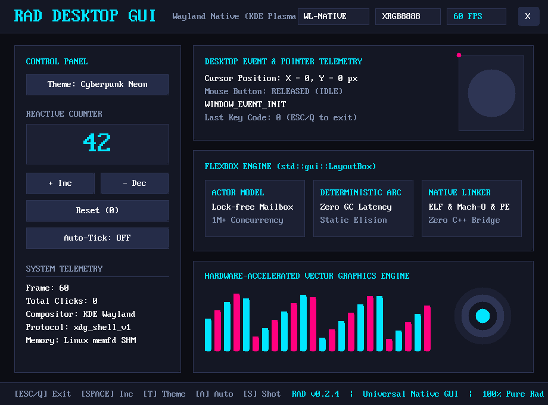

# Pure-Rad Universal Native Desktop GUI Showcase

An interactive, 60 FPS native desktop graphical application written in 100% pure **Rad** systems programming language, connecting directly to the Linux Wayland compositor (KDE Plasma) or X11 display server with **zero external C bridge files**, **zero C++ dependencies**, and **zero external GUI libraries** (no `libwayland-client`, no `libX11`, no Qt, GTK, Electron, or Skia).



---

## Highlights & Features

1. **100% Pure-Rad Display Server Communication**:
   - **Wayland Backend**: Pure Rad implementation of the Wayland wire protocol over AF_UNIX domain sockets (`/run/user/1000/wayland-1`).
     - Issues binary requests directly via POSIX `syscall3(1, fd, buf, len)`.
     - Allocates shared memory via `SYS_memfd_create` (319) and passes file descriptors to compositor via `SYS_sendmsg` (46) with `SCM_RIGHTS` control message headers.
     - Implements `wl_display`, `wl_registry`, `wl_shm`, `wl_shm_pool`, `wl_buffer`, `wl_compositor`, `wl_surface`, `xdg_wm_base`, `xdg_surface`, `xdg_toplevel`, `wl_seat`, and `wl_pointer`.
   - **X11 Backend**: Pure Rad implementation of the X11 core wire protocol over AF_UNIX domain sockets (`/tmp/.X11-unix/X0`).
     - Directly parses binary authentication cookies from `$XAUTHORITY` (`MIT-MAGIC-COOKIE-1`).
     - Performs client setup handshake, allocates XIDs, issues `CreateWindow` (opcode 1), `CreateGC` (opcode 55), `MapWindow` (opcode 8), and streams framebuffer scanlines via `PutImage` (opcode 72 ZPixmap).
   - **Automatic Backend Detection**: Automatically inspects runtime environment (`$WAYLAND_DISPLAY`, `$DISPLAY`) and activates the appropriate native protocol backend.

2. **Full `std::gui` Integration**:
   - High-level `Window` API: `Window::open(title, width, height)` or `Window::open_with_backend(title, width, height, backend)`.
   - Uses `std::gui::LayoutBox` flexbox engine to compute reactive horizontal layouts (`justify_content = JUSTIFY_SPACE_BETWEEN`).
   - Unified non-blocking event polling (`win.poll_event()`).

3. **Interactive UI Widgets**:
   - **Header Bar**: Title, window status pills (`[WL-NATIVE]` or `[X11-NATIVE]`, `[XRGB8888]`, `[60 FPS]`), and close window button `[X]`.
   - **Visual Themes**: Dynamic theme switcher cycling through **Cyberpunk Neon**, **Slate Modern**, and **Matrix Emerald**.
   - **Reactive Counter**: Large 3x font counter with `+ Inc`, `- Dec`, `Reset (0)`, and an asynchronous `Auto-Tick` mode.
   - **Real-Time Telemetry**: Live cursor coordinates `(X, Y)`, pointer button status (`PRESSED` / `RELEASED`), and an interactive mini radar reticle tracking cursor movement.
   - **Hardware-Independent Vector Graphics**: 24 animated neon audio-visualizer equalizer bars and concentric rotating radar circles.
   - **Status Bar**: Hotkey prompts and live backend telemetry.

4. **Keyboard & Mouse Hotkeys**:
   - `[ESC]` or `[Q]`: Cleanly destroy window surfaces and exit.
   - `[SPACE]`: Increment the counter.
   - `[T]`: Cycle through visual themes.
   - `[A]`: Toggle auto-tick mode.
   - `[S]`: Save an instant frame screenshot (`screenshot.bmp`).

---

## Architecture

```
┌────────────────────────────────────────────────────────┐
│                   demos/wayland_gui/main.rad           │
│  - AppState, event handling, flexbox layout, widgets   │
└──────────────────────────┬─────────────────────────────┘
                           │ import std/gui;
┌──────────────────────────▼─────────────────────────────┐
│                       std/gui (lib/rad/std/src/gui.rad)│
│  - Unified Window API (open, poll_event, present)      │
│  - Software Rasterizer (rect, rounded, text, bmp)      │
│  - Font Cache (embedded 8x16 bitmap font)              │
├──────────────────────────┬─────────────────────────────┤
│ WaylandBackend (Pure Rad)│ X11Backend (Pure Rad)       │
│ - AF_UNIX wire protocol  │ - AF_UNIX wire protocol     │
│ - SCM_RIGHTS fd passing  │ - .Xauthority cookie parser │
│ - memfd SHM buffer       │ - ZPixmap PutImage stream   │
└────────────┬─────────────┴───────────────┬─────────────┘
             │                             │
             ▼                             ▼
┌──────────────────────────┐  ┌──────────────────────────┐
│   Wayland Compositor     │  │        X11 Server        │
│      (KDE Plasma)        │  │     (/tmp/.X11-unix/X0)  │
└──────────────────────────┘  └──────────────────────────┘
```

---

## Building and Running

### Prerequisites
- Linux running Wayland or X11.
- Self-hosted Rad compiler `bin/radc` (v0.2.5).
- No external development libraries or headers needed!

### Build Single Command
```bash
./demos/wayland_gui/build.sh
# or directly:
bin/radc demos/wayland_gui/main.rad -o demos/wayland_gui/rad_wayland_demo
```

### Launch Interactive Application
```bash
./demos/wayland_gui/rad_wayland_demo
```

### Explicit Display Server Testing
```bash
# Run on Wayland (default on Wayland desktops):
./demos/wayland_gui/rad_wayland_demo

# Force run on X11:
WAYLAND_DISPLAY="" DISPLAY=":0" ./demos/wayland_gui/rad_wayland_demo

# Automated 60 frames test:
RAD_DEMO_FRAMES=60 ./demos/wayland_gui/rad_wayland_demo
```
